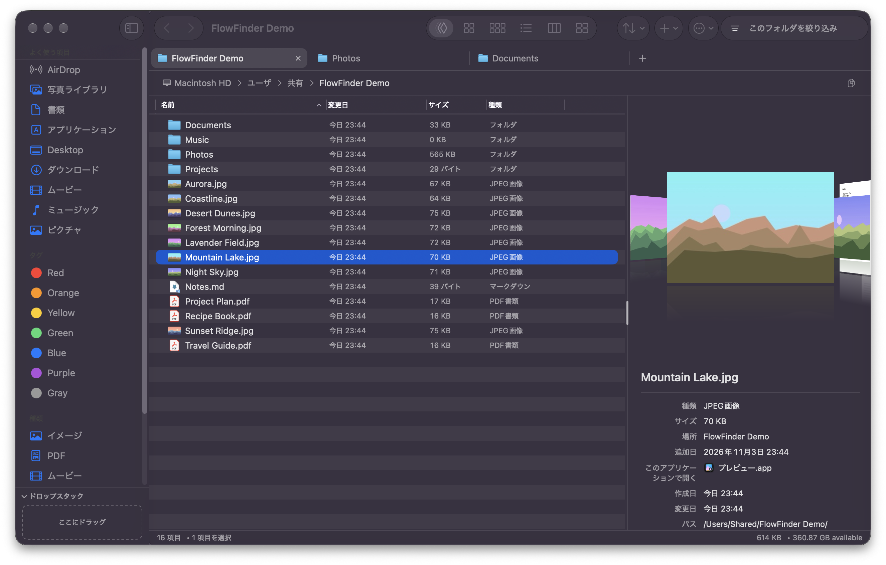
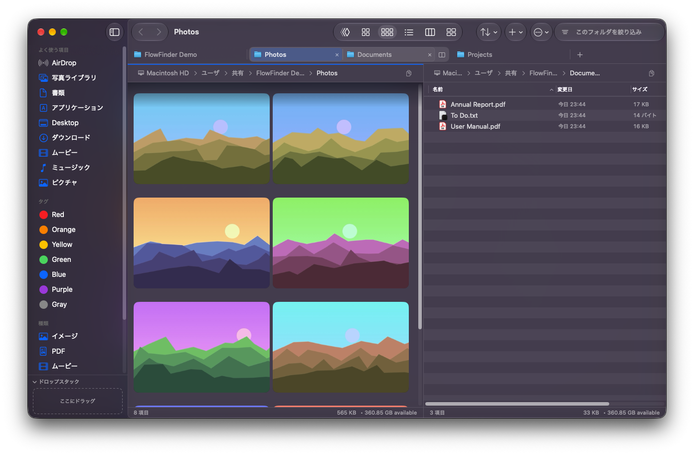

# Flow Finder（カスタム版）

Cover Flow が使える macOS のファイルブラウザ [CoverFlowFinder](https://github.com/elliotttate/CoverFlowFinder) を、Finder や XtraFinder の代わりに毎日使えるように改造したフォークです。タブと分割、サイドバーの編集、一括リネーム、フォルダの比較などを追加しています。

*An unofficial fork of [elliotttate/CoverFlowFinder](https://github.com/elliotttate/CoverFlowFinder) with Chrome-style tabs and split view, sidebar customization, batch rename, folder compare and more. The UI is localized in Japanese.*





## おもな機能

本家の機能（Cover Flow、アイコン・リスト・カラム表示、2 画面・4 画面、Quick Look、アーカイブの閲覧と作成など）に加えて、次の機能があります。すべての一覧は [CUSTOM_FEATURES.md](CUSTOM_FEATURES.md) にあります。

- **タブと分割**：Chrome のようなタブ。タブを画面の端へドラッグすると左右に分割でき、ペインごとに表示形式を変えられる。分割中は反対側へのコピー（F5）・移動（F6）ができる。
- **状態の保存**：タブ・分割・戻る／進むの履歴を保存し、再起動後に復元する。
- **Cover Flow パネル**：リストの右側に縦長の Cover Flow と情報欄（種類、サイズ、日付、解像度、開くアプリなど）を表示する。
- **サイドバーの編集**：項目の並べ替え・別名・アイコン変更・非表示、自分で作るグループ、種類（画像・PDF など）での絞り込み。
- **ファイル操作**：一括で名前を変更（正規表現・プレビュー付き）、フォルダの比較と同期、ドロップスタック、スマートフォルダ、フォルダの色とアイコン、圧縮・変換、テンプレートからの新規ファイル。
- **標準のアプリの変更**：「情報を見る」や「このアプリケーションで開く」から、書類ごと、または同じ種類の書類すべての既定アプリを変えられる。
- **Finder との連携**：Finder の右クリック「FlowFinder で開く」、フォルダを開く既定のアプリとしての利用。すでに開いているフォルダは、新しいタブを作らずにそのタブを前に出す。
- **そのほか**：Git の状態表示、トラックパッドのスワイプで戻る・進む、パスの入力とコピー、ターミナルで開く、Dock アイコンへの進捗表示、日本語表示。

## 動作環境

- macOS 15.0（Sequoia）以降
- ビルドには Xcode 26 以降が必要

## ビルドとインストール

配布用のビルドはありません。ソースからビルドしてください。

1. リポジトリをクローンする。
   ```bash
   git clone https://github.com/Ryuto42/CoverFlowFinder.git
   ```
2. `Config/Local.xcconfig` の `PRODUCT_BUNDLE_IDENTIFIER` と `DEVELOPMENT_TEAM` を自分のものに書き換える。バンドル ID を変えたときは、`FlowFinderFinderSync/FinderSync.swift` の `appBundleID` と `scripts/install-local.sh` の ID も合わせる。
3. Release ビルドを作り、`/Applications/FlowFinder.app` に入れる。
   ```bash
   scripts/install-local.sh
   ```

Debug ビルドだけを作るときは `scripts/build-local.sh` を使います。

## 本家の更新の取り込み

メニューの「アップデートを確認…」で本家の新しい版を確認できます。取り込みは次のスクリプトで行います。本家を `upstream` リモートとして登録し、取り込んだあとビルドとインストールまで行います。取り込んだ内容はコミットされないので、確認してから自分でコミットしてください。

```bash
scripts/update-from-upstream.command
```

## 本家について

アーキテクチャやビュー モードの追加方法は、本家のドキュメント [DEVELOPMENT.md](DEVELOPMENT.md) を参照してください。本家の配布版（[Releases](https://github.com/elliotttate/CoverFlowFinder/releases)）には、このフォークの改造は含まれません。

## ライセンス

MIT License です。詳しくは [LICENSE](LICENSE) を参照してください。本家 CoverFlowFinder（Copyright (c) 2025 Brian Tate）をもとにしています。
